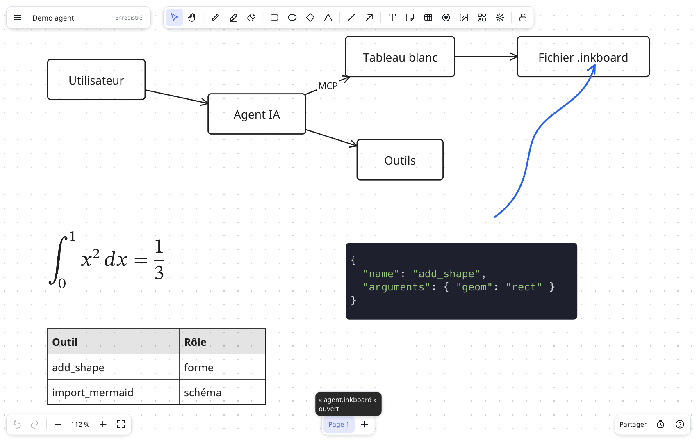
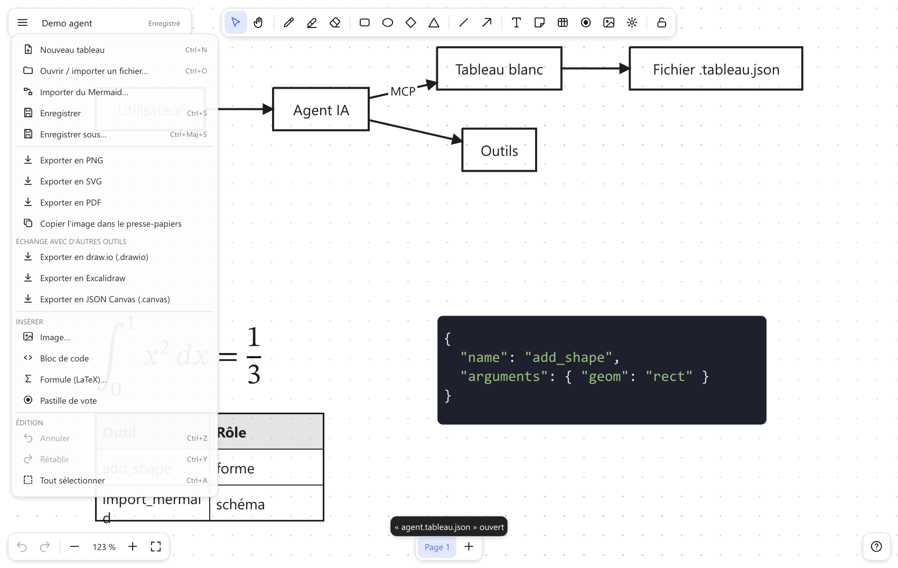
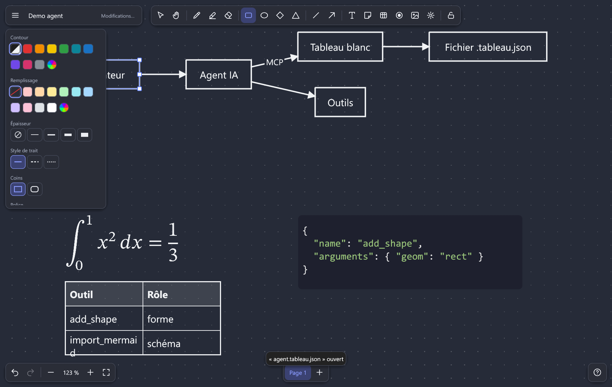

<p align="center"></p>

# Inkboard

🇬🇧 [English version](README.md) · 🇫🇷 Version française (ce fichier)

Inkboard (anciennement « Tableau blanc ») est un tableau blanc infini, **100 % hors ligne**, écrit en Rust. Il remplace l'application de bureau Microsoft Whiteboard et vise
les manques les plus souvent reprochés aux outils du genre (Miro, Excalidraw, draw.io, Whiteboard).

> État : **application native complète** (moteur, formats d'échange, texte riche, raccourcis, stylet, grands tableaux, présentation)  et **serveur MCP** pour piloter le tableau depuis un agent (niveau fichiers). Le prototype web d'origine est conservé dans
> [`prototype-web/`](prototype-web/) et reste utilisable ; ses fichiers `.tableau.json` s'importent dans la version Rust.

## Installer

Des installeurs (Windows `.exe`, Linux `.deb` / `.AppImage`, macOS `.dmg`) sont publiés sur la page *Releases* du dépôt à chaque version (voir [docs/DISTRIBUTION.md](docs/fr/DISTRIBUTION.md)) ;
ils ne sont pas encore signés (avertissement SmartScreen / Gatekeeper au premier lancement). Les versions actuelles sont des **release candidates** (`v0.2.0-rc.N`) : utilisées à la main sous Windows uniquement ; les versions Linux et macOS passent la CI mais n'ont pas été essayées à la main, et le stylet n'a pas été validé sur du vrai matériel. **Testeurs bienvenus** : voir le [guide de test en 10 minutes](docs/fr/TESTING.md).

**Sous Windows**, téléchargez `inkboard_*_x64-setup.exe` et double-cliquez : l'installation se fait pour votre utilisateur en quelques secondes (sans droits d'administrateur, rien à installer avant), ajoute un raccourci au menu Démarrer et se désinstalle proprement depuis *Paramètres → Applications*. Ajoutez `--silent` pour une installation silencieuse. Un paquet `winget` est en préparation (`winget install Inkboard.Inkboard`). Si la fenêtre ne s'ouvre pas : Inkboard bascule tout seul d'OpenGL à Direct3D / Vulkan ; la variable d'environnement `INKBOARD_RENDERER=wgpu` (ou `glow`) en force un ; en cas de plantage, il écrit `%APPDATA%\Inkboard\crash.log` et l'indique. La signature de code est prête à être activée dans le workflow de publication dès qu'un certificat existe ([comment](docs/fr/DISTRIBUTION.md)).

## Démarrer

```bash
cargo run --release -p inkboard-app                 # l'application
cargo run --release -p inkboard-app -- schema.drawio # ouvrir un fichier (draw.io, Excalidraw, JSON Canvas, Mermaid, ancien format)
cargo test --workspace                        # plus de 850 tests
cargo packager --release -c Packager.toml    # installeurs (voir docs/fr/DISTRIBUTION.md)
```

CLI de conversion (utile aux scripts et, plus tard, aux agents) :

```bash
cargo run --release -p inkboard-cli -- convert schema.mmd schema.drawio      # Mermaid → draw.io
cargo run --release -p inkboard-cli -- convert ancien.inkboard nouveau.png
cargo run --release -p inkboard-cli -- info schema.drawio
```

## Plateformes

| | Windows | Linux | macOS |
|---|---|---|---|
| Compilation et tests automatiques (plus de 850 tests, sans fenêtre réelle) | ✔ | ✔ passent en intégration continue | ✔ passent en intégration continue |
| Application lancée et utilisée à la main | ✔ | **jamais** | **jamais** |
| Page web d'invité (navigateur, rien à installer) | Chrome, Edge, Firefox testés | pas essayée | pas essayée (Safari **non testé**) |
| Gomme du stylet (`inkboard-pen`) | ✔ (non validée sur matériel) | – (sans effet) | – (sans effet) |
| Icône de l'exécutable, archive portable, installation par utilisateur | ✔ (`scripts/*.ps1`) | – | – |
| Dossier des données (autosave, raccourcis, mode direct MCP) | `%APPDATA%\Inkboard` | `$XDG_DATA_HOME` ou `~/.local/share/Inkboard` | `~/Library/Application Support/Inkboard` |

Le code est portable (Rust + egui, pas d'API propre à un système en dehors de `inkboard-pen`), mais seul Windows a été lancé et utilisé à la main : sous Linux et macOS, seuls les tests automatiques (sans fenêtre) ont tourné, en intégration continue. Sous Linux et macOS : polices système cherchées dans les dossiers habituels
(à défaut, les polices intégrées d'egui : Manuscrit et Serif y ressemblent à Sans), raccourcis avec Cmd à la place de Ctrl sous macOS, pas d'installateur ni de paquet. Le workflow CI
(`.github/workflows/ci.yml`) teste les trois systèmes et est vert (Rust stable 1.99).

## Contenu

| Crate | Rôle |
|---|---|
| [`inkboard-core`](crates/inkboard-core) | Modèle (pages, calques, objets), géométrie, **connecteurs liés**, historique, export SVG, mise en page automatique. Aucune dépendance à une interface. |
| [`inkboard-formats`](crates/inkboard-formats) | Import/export draw.io, Excalidraw, JSON Canvas ; import Mermaid ; ancien format du prototype ; rendu PNG. |
| [`inkboard-mcp`](crates/inkboard-mcp) | Serveur MCP (stdio) : un agent crée/modifie des tableaux, importe du Mermaid, exporte. Voir [docs/MCP.md](docs/fr/MCP.md). |
| [`inkboard-pen`](crates/inkboard-pen) | Seul crate contenant du `unsafe` : lecture de l'état de la gomme du stylet (messages `WM_POINTER*` de Windows). |
| [`inkboard-cli`](crates/inkboard-cli) | `ink convert`, `ink info`, `ink bench`. |
| [`inkboard-app`](crates/inkboard-app) | Application de bureau (egui) : canvas, outils, panneau de style, pages, calques, texte riche, raccourcis personnalisables, dialogues. Aussi compilée pour le web (page d'invité). |
| [`inkboard-session`](crates/inkboard-session) | Partage en direct : protocole, chiffrement de bout en bout, séquenceur de l'hôte, client invité, simulateur de réseau. |
| [`inkboard-net`](crates/inkboard-net) | Transport réseau des sessions (QUIC avec repli par relais, natif et navigateur) et diagnostic du relais. |
| [`inkboard-fonts`](crates/inkboard-fonts) | Les polices intégrées à l'application (mise en page du texte identique partout, navigateur compris). |
| [`inkboard-crowd`](crates/inkboard-crowd) | Outil de test de charge : un vrai hôte et des invités simulés. |

## Interface

L'interface reprend celle du prototype web : un canevas plein écran et des **cartes flottantes** (blanches, bordées, ombrées, coins de 10 px) — titre et menu en haut à gauche,
outils au centre en haut, réglages de style à gauche (visibles seulement quand il y a quelque chose à régler), annuler / zoom en bas à gauche, pages au centre en bas, aide en bas à droite.
Mêmes icônes (jeu SVG du prototype), mêmes couleurs, mêmes boutons segmentés, menu principal à entrées contiguës avec raccourcis, thème **clair et sombre** qui suit le fond du tableau.



**Le partage en direct, depuis une page web :** deux invités dans un navigateur et l'agent d'IA modifient le même tableau, en temps réel (enregistré avec de vrais invités navigateur et un vrai hôte : [`demo.mjs`](crates/inkboard-app/web/test/demo.mjs)).


| Menu principal | Thème sombre et réglages de style |
|---|---|
|  |  |

## Fonctions notables

- **Connecteurs liés** (droits, coudés, courbes) qui suivent les formes ; les coudés **contournent les formes** rencontrées ; poignées de
  **points de passage** (glisser le rond creux au milieu d'un tronçon pour en créer un, Alt+clic pour le retirer, menu « Redresser »).
- **Stylet** : la pression fait varier l'épaisseur du trait (écran, SVG, Excalidraw) ; l'**extrémité gomme** du stylet efface, quel que soit l'outil actif (Windows, via l'API Pointer — voir `inkboard-pen`). **À valider avec un vrai stylet** : `inkboard --pen-test` affiche un diagnostic et produit un rapport ([docs/STYLET.md](docs/fr/STYLET.md)).
- **Presse-papiers système** : copier/coller d'objets, d'images et de texte.
- **Style** : ombre portée, taille des pointes de flèche, et n'importe quelle couleur d'un SVG importé remplacée par une autre (logos multicolores compris).
- **Coller depuis un tableur** : une plage copiée depuis Excel, LibreOffice ou Google Sheets devient un tableau.
- **Bibliothèque d'icônes** : environ 28 800 icônes et formes hors ligne — AWS, Azure, Google Cloud, Cisco, IBM, Kubernetes, formes d'organigramme / BPMN, symboles électriques et de procédé, éléments de maquette, 3 400 logos de marques et 14 500 icônes générales — avec recherche depuis la barre d'outils ([détails et licences](docs/fr/ICONS.md)).
- **Menu Insérer** : bloc de code (police à chasse fixe, coloration syntaxique avec choix du langage), **formule LaTeX composée** (vraie typographie TeX, police STIX Two Math embarquée : fractions, racines, sommes, intégrales, matrices ; double-clic pour la modifier, couleur = couleur de trait, source conservée),
  pastilles de vote (outil dédié).
- **Présentation** (F5) : plein écran sans interface, flèches / espace / Page↓ pour changer de page, Échap pour quitter ; **minuteur** (menu Affichage).
- **Pointeur laser** (F) : une traînée rouge qui s'efface, pour montrer sans dessiner ; en présentation, F l'active.
- **Exports** : draw.io, Excalidraw, JSON Canvas, SVG, PNG, **PDF vectoriel**.
- **Agents (MCP)** : `inkboard-mcp --root <dossier>` expose 27 outils (formes, connecteurs liés, tableaux, code, formules, Mermaid, mise en page, export, icônes de la bibliothèque intégrée (28 800), `render` qui renvoie le tableau en image, `batch` pour enchaîner plusieurs opérations en un appel). **Ressources MCP** (tableau affiché, fichiers) avec notifications d'abonnement, outil `board_changes` (ce que vous avez modifié depuis le dernier regard de l'agent), insertion d'images. **Mode direct** : application ouverte, l'agent agit sur le tableau affiché (une étape d'annulation par appel, il voit votre sélection) ; sinon il modifie le fichier et l'application le recharge seule.
- **Distribution** : icône, archive portable et installation par utilisateur (voir [docs/DISTRIBUTION.md](docs/fr/DISTRIBUTION.md)).

## Texte riche et raccourcis

- **Texte riche** : double-clic sur une forme, un tableau ou une flèche, puis sélection de mots (souris ou Maj+flèches) →
  gras (Ctrl+B), italique (Ctrl+I), souligné (Ctrl+U), barré, **couleur** et **surlignage** par mot, via la barre flottante
  ou le panneau de droite. Sans sélection, la mise en forme s'applique à tout le texte ; hors édition, à tout le texte des
  objets sélectionnés. La frappe continue dans le style du caractère précédent.
- **Raccourcis personnalisables** : menu *Affichage → Raccourcis clavier…* (41 commandes, plusieurs raccourcis par commande,
  recherche, réinitialisation par commande ou globale, remplacement automatique en cas de conflit). Réglages dans
  `%APPDATA%\Inkboard\keymap.json` (modifiable à la main ; les entrées invalides sont ignorées et signalées).
  Réservés : Échap, flèches (déplacement fin), Ctrl+C/X/V.

## Formats

| Format | Ouvrir | Enregistrer / exporter |
|---|---|---|
| Natif `.inkboard` (v2, versionné ; JSON) | ✔ | ✔ (enregistrement atomique + sauvegarde automatique) |
| Prototype web `.tableau.json` (v1) | ✔ | – |
| draw.io `.drawio` (compressé ou non, multi-pages) | ✔ | ✔ |
| Excalidraw `.excalidraw` | ✔ | ✔ |
| JSON Canvas `.canvas` | ✔ | ✔ (formes avec texte et flèches entre formes) |
| Mermaid (`flowchart`, `stateDiagram`, `sequenceDiagram`, `classDiagram`, `erDiagram`) | ✔ | – |
| SVG, PNG, PDF | – | ✔ |

Les tableaux s'enregistrent en `.inkboard` (du JSON ; l'installeur associe l'extension : un double-clic ouvre le fichier). Les fichiers `.inkboard.json` des versions précédentes et les `.tableau.json` du prototype restent lisibles ; un `.inkboard.json` rouvert est réenregistré sous son propre nom.

## Performances (mesurées)

`inkboard --bench fichier` mesure le temps CPU de construction d'une image en vue « tout afficher » avec zoom et défilement
continus (build release). Plateau synthétique `ink bench N` : 60 % formes avec texte, 25 % traits, 15 % connecteurs liés.

| Objets | Avant optimisation | Après (vue « tout afficher ») | Après (zoom 100 %) |
|---|---|---|---|
| 2 000 | 2,9 ms | 0,8 ms | 0,3 ms |
| 20 000 | 199 ms | 3,3 ms | 0,3 ms |
| 100 000 | > 2 min (inutilisable) | 4,5 ms | 0,3 ms |

Moyens : table des identifiants et **index spatial en grille** reconstruits une fois par modification (28 ms pour 100 000 objets),
niveau de détail (objets de moins de 3 px dessinés comme des points), sélection et survol par l'index (< 0,01 ms).
L'index n'est utilisé qu'à partir de 400 objets et suspendu pendant les gestes qui déplacent des objets.

## Partage en direct

> **Bêta.** Le partage en direct est récent : il a été éprouvé par des tests automatiques (dont des foules simulées jusqu'à 100 invités et des entrées hostiles) et à la main sur quelques appareils et réseaux, mais pas encore largement.

Cliquez sur **Partager** (en bas à droite) pour obtenir un lien ; les personnes qui l'ouvrent modifient le même tableau en direct.

- **Aucun serveur à installer.** Votre ordinateur héberge la session ; rien ne tourne ailleurs et rien ne se connecte avant que vous démarriez le partage.
- **Rejoindre depuis l'application ou depuis une page web.** Un invité qui a Inkboard colle le lien ; un invité qui n'a qu'un navigateur ouvre le **lien web** (bouton *Copier le lien web*) : rien à installer, pas de compte. La page web est une page statique, [victorletirand.github.io/inkboard](https://victorletirand.github.io/inkboard/) (Chrome, Edge et Firefox testés ; Safari et iOS non testés). Elle sert seulement à rejoindre, pas à héberger.
- **Noms et curseurs en direct** pour l'hôte, chaque invité et **l'agent d'IA** (son curseur et ce qu'il fait sont montrés à tous).
- **Vous gardez la main.** Vous acceptez chaque personne, avec un lien de *modification* ou de *lecture seule* ; de nouveaux liens coupent les anciens ; vous pouvez renommer, restreindre ou retirer n'importe qui. Plafond par défaut : 10 participants (conçu pour 20, testé en charge avec 100 simulés).
- **Privé par conception.** Chiffré de bout en bout : le relais qui aide deux ordinateurs à se trouver ne voit que des octets chiffrés. Chaque invité n'annule que ses propres modifications.
- **Fonctionne entre réseaux.** Connexion directe quand c'est possible, par un relais sinon (public par défaut, [vous pouvez héberger le vôtre](docs/fr/RELAY.md)). Essayé en Wi-Fi, en 5G et entre Windows et Linux ; il supporte des coupures d'une minute et se reconnecte seul.
- **Limites assumées.** Certains réseaux d'entreprise (passerelles qui inspectent le TLS) bloquent le relais public : l'application le dit et propose un bouton *Copier le diagnostic* à remettre à votre service informatique. Les très gros tableaux (20 000 objets et plus) mettent quelques secondes à arriver chez un nouvel invité ; 100 invités fonctionnent mais ce n'est pas un usage normal. Voir [partager et rejoindre](docs/fr/SHARING.md) · [la page web](docs/fr/WEB.md) · [héberger son relais](docs/fr/RELAY.md).

## Documentation

- [Architecture et décisions](docs/fr/ARCHITECTURE.md)
- [Feuille de route et état des « plaintes » des utilisateurs](docs/fr/ROADMAP.md)

## Licence

Inkboard est un logiciel libre en **double licence** : vous pouvez l'utiliser sous **l'une ou l'autre** des deux licences ci-dessous. **Vous en choisissez une seule** ; il n'est pas nécessaire de respecter les deux.

| | [MIT](LICENSE-MIT) | [Apache-2.0](LICENSE-APACHE) |
|---|---|---|
| L'utiliser, y compris dans un produit commercial | ✔ | ✔ |
| Le modifier et le redistribuer | ✔ | ✔ |
| Conserver la mention de copyright et de licence | ✔ | ✔ |
| Licence de brevet explicite de la part des contributeurs | – | ✔ |
| Longueur du texte | très court | plus long |

*Laquelle choisir ?* L'une ou l'autre convient. MIT est la plus courte et la plus simple ; Apache-2.0 ajoute la licence de brevet explicite. Ce tableau est un résumé en langage courant, pas un avis juridique : les deux fichiers de licence font foi.

Les licences des composants tiers embarqués sont dans [THIRD_PARTY_LICENSES.md](THIRD_PARTY_LICENSES.md). Contributions : [CONTRIBUTING.md](CONTRIBUTING.md) ; toute contribution est placée sous la même double licence.
