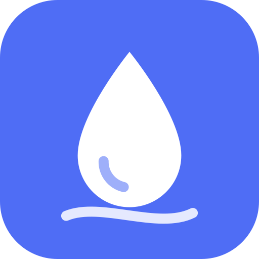
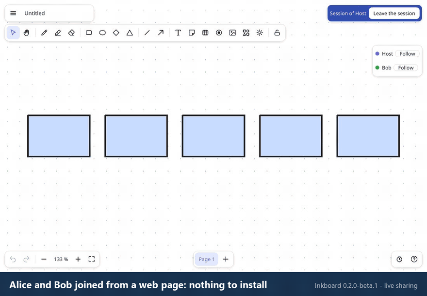
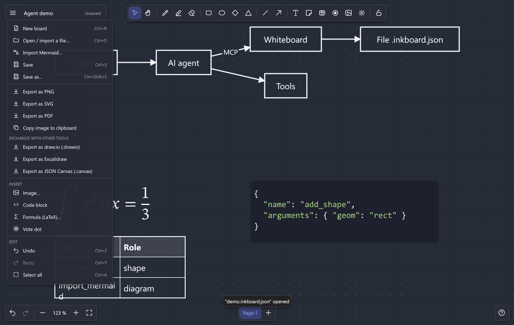
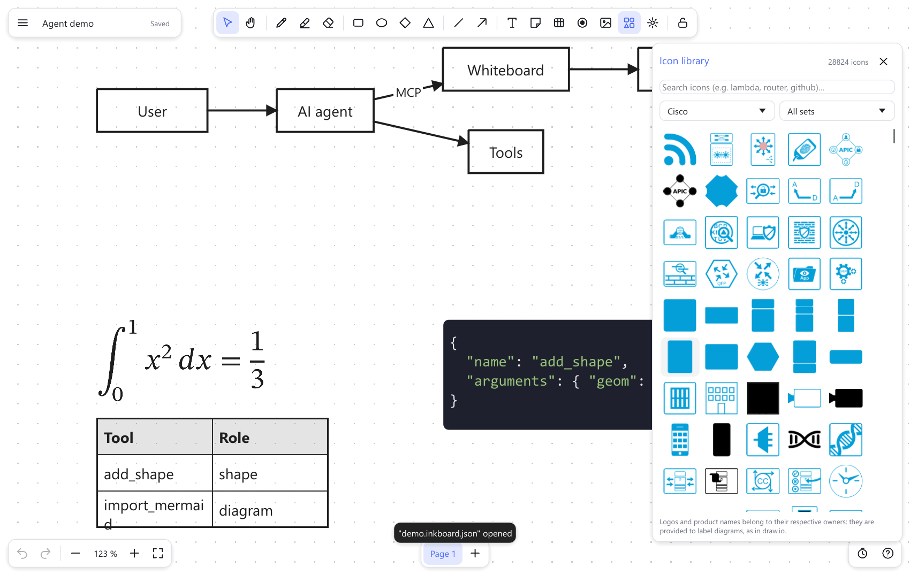

<p align="center"></p>

# Inkboard

**A fast, free, fully offline infinite whiteboard — written in Rust.**
Draw, diagram and present on a native desktop app, import and export the formats you already use, **share a board live with people on other networks (even from a web page, with nothing to install)**, and let an AI agent draw on your board.

[](https://github.com/VictorLetirand/inkboard/actions/workflows/ci.yml)
[](#license)


🇬🇧 English · 🇫🇷 [Version française](README.fr.md)


**Live sharing, from a web page:** two guests in a browser and the AI agent edit the same board, in real time (recorded with real browser guests and a real host: [`demo.mjs`](crates/inkboard-app/web/test/demo.mjs)).



> **Status: alpha.** Inkboard is a young project. It is feature-rich and heavily tested (over 850 automated tests), but it has so far been **used by hand on Windows only** (live sharing was also tried between several computers, an Android phone on 5G and a Linux server).
> Linux and macOS builds compile and pass the automated tests in CI, yet nobody has used the app there yet — expect rough edges, and please [report them](../../issues).
> The interface is available in **English and French**; it follows your system language and can be switched from the menu (*Language*).

## Why Inkboard?

Microsoft retired the standalone **Microsoft Whiteboard** apps for Windows, iOS and Android on October 16, 2026 ([announcement](https://support.microsoft.com/en-us/whiteboard/retirement-standalone-microsoft-whiteboard-apps)), and the web alternatives all want an account, an internet connection, or a subscription.
We wanted a whiteboard that is:

- **Offline and private.** No account, no cloud, no telemetry. Your boards are plain files on your disk.
- **Fast on big boards.** Complaints about lag on large boards come up again and again for Miro, Excalidraw and Whiteboard. Inkboard stays smooth with 100 000 objects (≈ 4.5 ms per frame).
- **Interoperable.** Open and export **draw.io**, **Excalidraw**, **JSON Canvas** (Obsidian) and **Mermaid**, plus SVG, PNG and PDF. Your work is never locked in.
- **Solid where other tools are fragile.** Connectors that really stay attached (and route around shapes), real tables, layers, rich text with per-word colour and highlight, LaTeX formulas typeset like TeX, customizable shortcuts, pen pressure.
- **Shareable without a server.** Click *Share*: your computer *is* the server. Guests join from the app or from a web page, see everyone's cursor (the AI agent's too), and everything is end-to-end encrypted. See [Live sharing](#live-sharing).
- **Ready for AI agents.** A built-in [MCP server](#use-it-with-ai-agents-mcp) lets Claude (or any MCP client) create and edit boards — live, in the open app, with every step undoable.
- **Free software.** Dual-licensed **MIT OR Apache-2.0**, built on a small, UI-independent Rust engine you can reuse.

Before writing a line of code we surveyed what users keep asking for in whiteboard tools (performance, fragile connectors, tables, layers, exports, offline use, pen support…); the [roadmap](docs/ROADMAP.md) tracks each of those requests.

## Install

### Download (recommended)

Grab the installer for your system from the [**Releases**](../../releases) page (pre-releases while Inkboard is in alpha):

| System | File | Notes |
|---|---|---|
| **Windows 10/11** | `inkboard_*_x64-setup.exe` | Installs for the current user (no administrator rights needed). |
| **Linux** (x86-64) | `inkboard_*_amd64.deb` or `inkboard_*_x86_64.AppImage` | `sudo apt install ./inkboard_*.deb`, or `chmod +x *.AppImage && ./*.AppImage`. Needs OpenGL and X11/Wayland libraries (`libxkbcommon`). |
| **macOS** (Apple Silicon / Intel) | `Inkboard_*.dmg` | Drag *Inkboard* to *Applications*. |

The installers also provide the `ink` command-line tool and the `inkboard-mcp` server next to the app.

**On Windows**, download `inkboard_*_x64-setup.exe` and double-click it: it installs for your user in a few seconds (no administrator rights, nothing else to install first), adds a Start menu shortcut, and uninstalls cleanly from *Settings → Apps*. Add `--silent` for a silent install. A `winget` package is being prepared (`winget install Inkboard.Inkboard`).

> **The installers are not code-signed yet**, so your system will warn you the first time:
> on **Windows**, SmartScreen says "Windows protected your PC" → *More info* → *Run anyway*; on **macOS**, Control-click the app → *Open*.
> Every release lists SHA-256 checksums so you can verify your download. Code signing is ready to be switched on in the release workflow as soon as a signing certificate is available ([how](docs/DISTRIBUTION.md#signing-recommended-it-is-what-removes-the-windows-warning)).

**If the window does not open on Windows:** Inkboard uses OpenGL and falls back to Direct3D / Vulkan by itself; you can force one with the environment variable `INKBOARD_RENDERER=wgpu` (or `glow`). If it ever crashes, it writes `%APPDATA%\Inkboard\crash.log` and tells you where.

### Build from source

You need [Rust](https://rustup.rs) 1.91 or newer.

```bash
git clone https://github.com/VictorLetirand/inkboard.git
cd inkboard
cargo run --release -p inkboard-app                    # start the app
cargo run --release -p inkboard-app -- diagram.drawio  # …or open a file directly
```

To build the installers yourself: `cargo install cargo-packager --locked`, then `cargo packager --release -c Packager.toml` ([details](docs/DISTRIBUTION.md)).

## Features

- **Drawing:** pen with pressure, highlighter, eraser, rectangles, ellipses, diamonds, triangles, lines, arrows, sticky notes, text, images, tables, vote dots, laser pointer. Infinite canvas, pages, layers, groups, alignment and distribution, snapping, undo/redo.
- **Smart connectors:** arrows are *bound* to shapes and follow them; elbow connectors route around other shapes; drag a midpoint handle to add a waypoint.
- **Rich text:** select words inside any shape, table cell or arrow label and make them bold, italic, underlined, struck, coloured or highlighted.
- **Icon library:** about 28,800 icons and shapes, offline — AWS, Azure, Google Cloud, Cisco, IBM, Kubernetes, flowchart / BPMN / UML-style shapes, electrical and process symbols, mockup widgets, 3,400 brand logos and 14,500 general-purpose icons — searchable from the toolbar ([details and licenses](docs/ICONS.md)).
- **Formulas and code:** LaTeX typeset with the STIX Two Math font (fractions, roots, sums, integrals, matrices…), editable by double-click; syntax-coloured code blocks with a language picker (Rust, JavaScript/TypeScript, Python, C/C++, C#, Java, Go, Shell, SQL, JSON, HTML, CSS, YAML).
- **Present:** full-screen page-by-page mode (**F5**), countdown timer (bottom-right clock button), laser pointer (**F**).
- **Import / export:**

  | Format | Open | Save / export |
  |---|---|---|
  | Inkboard `.inkboard` | ✔ | ✔ (atomic save + autosave) |
  | draw.io `.drawio` (compressed or not, multi-page) | ✔ | ✔ |
  | Excalidraw `.excalidraw` | ✔ | ✔ |
  | JSON Canvas `.canvas` (Obsidian) | ✔ | ✔ |
  | Mermaid (flowchart, state, sequence) | ✔ | – |
  | SVG, PNG, PDF (vector) | – | ✔ |

- **Customizable shortcuts** (41 commands, several shortcuts per command, conflict handling) and a **light/dark theme** that follows the board background.
- **File extension:** boards are saved as `.inkboard` (a JSON file; the installer makes a double-click open it). Boards saved by earlier builds as `.inkboard.json` (and the prototype's `.tableau.json`) still open, and are saved back under their own name.
- **Command line:** `ink convert diagram.mmd diagram.drawio`, `ink convert board.inkboard board.png`, `ink info file.drawio`.

| Main menu | Dark theme |
|---|---|
|  |  |



## Live sharing

> **Beta.** Live sharing is new: it has been exercised by automated tests (including simulated crowds of up to 100 guests and hostile inputs) and by hand on a few devices and networks, but not yet widely.

Click **Share** in the bottom-right corner to get a link; people who open it edit the same board live.

- **No server to install.** Your computer hosts the session; nothing runs anywhere else, and nothing connects until you start sharing.
- **Join from the app or from a web page.** A guest with the Inkboard app pastes the link; a guest with only a browser opens the **web link** (button *Copy web link*): nothing to install, no account. The web page is a static page, [victorletirand.github.io/inkboard](https://victorletirand.github.io/inkboard/) (Chrome, Edge and Firefox are tested; Safari and iOS are not). It only joins sessions, it cannot host one.
- **Names and live cursors** for the host, every guest and the **AI agent** (its cursor and what it is doing are shown to everyone).
- **You stay in control.** You approve each person, with an *edit* link or a *read-only* link; new links cut off the old ones; you can rename, restrict or remove anyone. Default cap: 10 participants (designed for 20, load-tested with 100 simulated ones).
- **Private by design.** End-to-end encrypted: the relay that helps two computers find each other only sees encrypted bytes. A guest can undo only their own edits.
- **Works across networks.** Connections are direct when possible and go through a relay otherwise (a public one by default, [you can run your own](docs/RELAY.md)). Tried on Wi-Fi, on 5G and between Windows and Linux; it survives network cuts of a minute and reconnects on its own.
- **Honest limits.** Some company networks (TLS-inspecting gateways) block the public relay: the app then says so and offers a *Copy the diagnostic* button to hand to your IT department. Very large boards (20,000 objects and more) take a few seconds to reach a new guest; 100 guests work but are not a normal use. See [how to share and join](docs/SHARING.md) · [the web page](docs/WEB.md) · [host your own relay](docs/RELAY.md).

## Use it with AI agents (MCP)

`inkboard-mcp` is a [Model Context Protocol](https://modelcontextprotocol.io) server: an agent can create shapes, bound connectors, tables, code blocks, formulas, images and whole Mermaid diagrams, lay them out automatically, and export.
With Inkboard **open**, the agent edits the board you are looking at — each call is one undo step, it can see what you have selected, and it can ask what *you* changed since it last looked.
With Inkboard **closed**, it edits the `.inkboard` file and the app reloads it automatically.

With [Claude Code](https://claude.com/claude-code):

```bash
claude mcp add inkboard -- /path/to/inkboard-mcp --root /path/to/your/boards
```

**Always pass `--root`**: it confines every file the agent can read or write to that folder. The server exposes 27 tools (`add_shape`, `add_connector`, `import_mermaid`, `add_icon` (28,800 icons), `render` (the board as an image), `batch`, `export`, `board_changes`…) and MCP resources with change notifications.
Full reference, security notes and limits: [docs/MCP.md](docs/MCP.md).

## Platform status

| | Windows | Linux | macOS |
|---|---|---|---|
| Builds and passes the automated tests (CI) | ✔ | ✔ | ✔ |
| Web guest page (browser, nothing to install) | Chrome, Edge, Firefox tested | not tried | not tried (Safari **not tested**) |
| App launched and used by hand | ✔ | not yet | not yet |
| Installers | built and tested | built in CI, untested | built in CI, untested |
| Pen eraser end (Windows Pointer API) | ✔ implemented, **not yet validated on real pen hardware** | – | – |

Pen pressure and the eraser end are implemented and covered by tests but **have never been tried with a real pen**: run `inkboard --pen-test` for a diagnostic report ([how](docs/STYLET.md)).

## Performance

Measured on the release build with a synthetic board (60 % labelled shapes, 25 % strokes, 15 % bound connectors), continuous zoom and pan:

| Objects | Frame time (fit-to-screen) | Frame time (100 % zoom) |
|---|---|---|
| 2 000 | 0.8 ms | 0.3 ms |
| 20 000 | 3.3 ms | 0.3 ms |
| 100 000 | 4.5 ms | 0.3 ms |

Reproduce with `ink bench 100000 big.inkboard && inkboard --bench big.inkboard`.

## Project layout

| Crate | Role |
|---|---|
| [`inkboard-core`](crates/inkboard-core) | The engine: document model, geometry, bound connectors, history, SVG export, auto-layout. No UI dependency. |
| [`inkboard-formats`](crates/inkboard-formats) | draw.io, Excalidraw, JSON Canvas, Mermaid, PNG/PDF, LaTeX typesetting. |
| [`inkboard-app`](crates/inkboard-app) | The desktop app (egui), also built for the web (guest page). |
| [`inkboard-session`](crates/inkboard-session) | Live sharing: protocol, end-to-end encryption, host sequencer, guest client, network simulator. |
| [`inkboard-net`](crates/inkboard-net) | Network transport of sessions (QUIC with relay fallback, native and browser) and relay diagnostics. |
| [`inkboard-fonts`](crates/inkboard-fonts) | The fonts built into the app (identical text layout on every platform and in the browser). |
| [`inkboard-crowd`](crates/inkboard-crowd) | Load-testing tool: a real host and simulated guests. |
| [`inkboard-cli`](crates/inkboard-cli) | The `ink` command-line converter. |
| [`inkboard-mcp`](crates/inkboard-mcp) | The MCP server. |
| [`inkboard-pen`](crates/inkboard-pen) | Pen eraser detection on Windows (the only crate with `unsafe` code). |

More: [architecture and design decisions](docs/ARCHITECTURE.md) · [roadmap](docs/ROADMAP.md) · [distribution and signing](docs/DISTRIBUTION.md) (French copies in [`docs/fr/`](docs/fr)).
The original web prototype is kept in [`prototype-web/`](prototype-web/); its `.tableau.json` boards can be opened in Inkboard.

## Roadmap

Planned or wanted next:

- **More interface languages** — English and French are built in; adding one means adding a translation table (see `crates/inkboard-app/src/i18n_fr.rs`).
- Code-signed installers (Windows via SignPath, macOS notarization) and automatic updates.
- Validation of pen pressure and eraser on real hardware; pen eraser support on macOS/Linux.
- First real-world usage on Linux and macOS, and fixes that come out of it.
- Real LaTeX beyond what the typesetting library supports; per-language code highlighting.

Have an idea or found a bug? [Open an issue](../../issues/new/choose) — see also [CONTRIBUTING.md](CONTRIBUTING.md).

## License

Inkboard is free software and is **dual-licensed**: you may use it under **either** of the two licenses below. **You choose one**; you do not have to follow both.

| | [MIT](LICENSE-MIT) | [Apache-2.0](LICENSE-APACHE) |
|---|---|---|
| Use it, including in a commercial product | ✔ | ✔ |
| Modify it and redistribute it | ✔ | ✔ |
| Keep the copyright and license notice | ✔ | ✔ |
| Explicit patent license from the contributors | – | ✔ |
| Length of the text | very short | longer |

*Which one should I pick?* Either is fine. MIT is the shortest and simplest; Apache-2.0 adds the explicit patent grant. This table is a plain-language summary, not legal advice: the two license files are the reference.

Third-party components keep their own (permissive) licenses: see [THIRD_PARTY_LICENSES.md](THIRD_PARTY_LICENSES.md).
Unless you explicitly state otherwise, any contribution intentionally submitted for inclusion in Inkboard shall be dual-licensed as above, without any additional terms or conditions.
